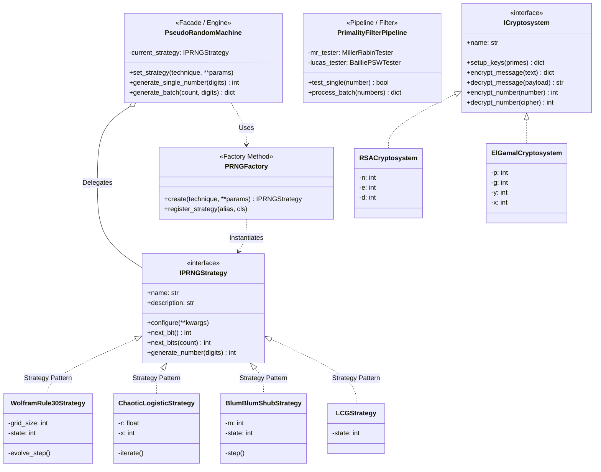
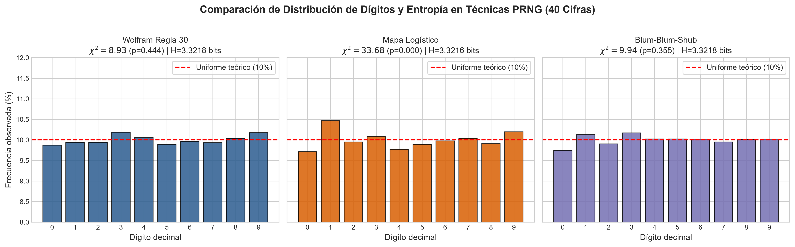
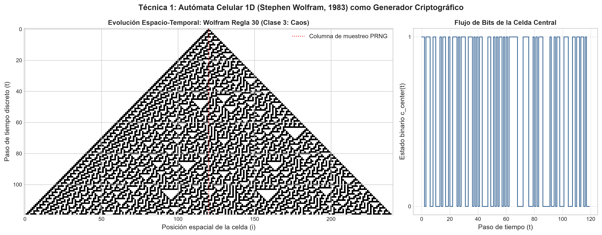
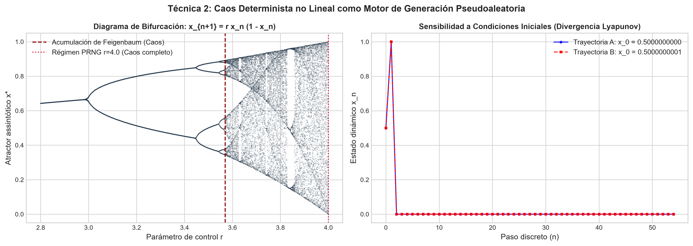
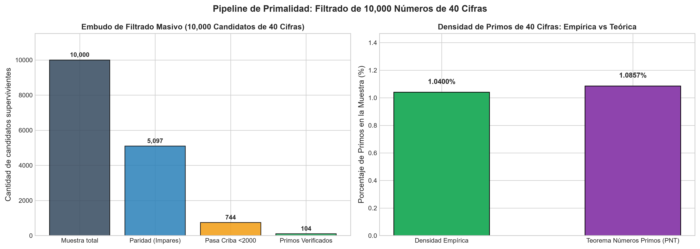
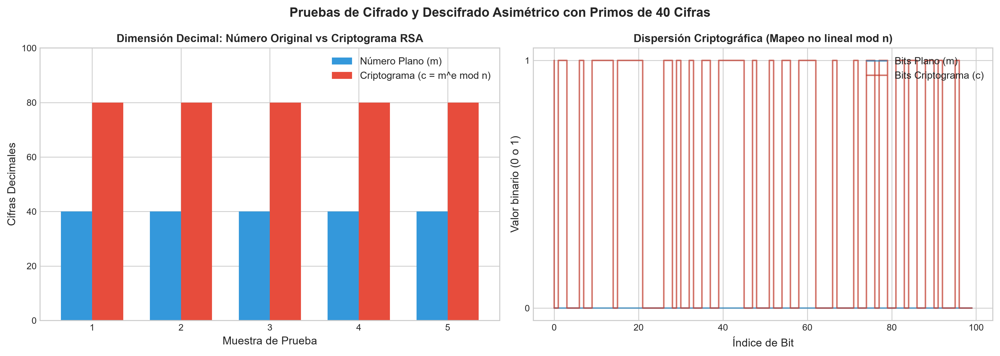

# Máquina Criptográfica de Números Pseudoaleatorios y Primos Grandes (40 Cifras)

[](https://www.python.org/)
[](LICENSE)
[]()
[]()

**Universidad Sergio Arboleda**  
**Escuela de Ciencias Exactas e Ingeniería**  
**Programa de Ciencias de la Computación e Inteligencia Artificial**  
*Asignatura: Sistemas Complejos — Parcial 2*  

---

## Tabla de Contenidos

1. [Enunciado y Objetivos](#enunciado-y-objetivos)
2. [Arquitectura de Software y Patrones de Diseño](#arquitectura-de-software-y-patrones-de-diseño)
3. [Estructura del Proyecto](#estructura-del-proyecto)
4. [Técnicas de Generación Pseudoaleatoria (Sistemas Complejos)](#técnicas-de-generación-pseudoaleatoria-sistemas-complejos)
   - [Técnica 1: Autómata Celular 1D (Regla 30 de Stephen Wolfram)](#técnica-1-autómata-celular-1d-regla-30-de-stephen-wolfram)
   - [Técnica 2: Mapa Dinámico Caótico No Lineal (Logístico con Perturbación)](#técnica-2-mapa-dinámico-caótico-no-lineal-logístico-con-perturbación)
   - [Técnica 3: Generador Criptográfico Blum-Blum-Shub (BBS)](#técnica-3-generador-criptográfico-blum-blum-shub-bbs)
   - [Técnica Adicional: LCG de 128 Bits (Benchmark Comparativo)](#técnica-adicional-lcg-de-128-bits-benchmark-comparativo)
5. [Pipeline de Detección de Números Primos](#pipeline-de-detección-de-números-primos)
   - [Embudo Multi-Etapa y Criba de Primos Pequeños](#embudo-multi-etapa-y-criba-de-primos-pequeños)
   - [Test de Miller-Rabin y Certificación Baillie-PSW](#test-de-miller-rabin-y-certificación-baillie-psw)
   - [Confrontación con el Teorema de los Números Primos (PNT)](#confrontación-con-el-teorema-de-los-números-primos-pnt)
6. [Sistemas de Encriptación Asimétrica](#sistemas-de-encriptación-asimétrica)
   - [Criptosistema RSA con Módulo de ~80 Cifras](#criptosistema-rsa-con-módulo-de-80-cifras)
   - [Criptosistema ElGamal sobre un Primo de 40 Cifras](#criptosistema-elgamal-sobre-un-primo-de-40-cifras)
   - [Encriptación y Descifrado de Mensajes de Texto](#encriptación-y-descifrado-de-mensajes-de-texto)
   - [Pruebas de Encriptación Directa de Números](#pruebas-de-encriptación-directa-de-números)
7. [Instalación y Guía de Uso](#instalación-y-guía-de-uso)
8. [Resultados Experimentales y Visualizaciones](#resultados-experimentales-y-visualizaciones)
9. [Suite de Pruebas Automatizadas](#suite-de-pruebas-automatizadas)
10. [Conclusiones](#conclusiones)

---

## Enunciado y Objetivos

El examen plantea los siguientes requerimientos formales:

> 1. **Diseño e implementación de una máquina para generar salidas de números de 40 cifras pseudoaleatorios**, ingresando los parámetros que se requieran.
> 2. **La máquina debe disponer de al menos tres técnicas diferentes** para generar los números pseudoaleatorios.
> 3. **Generar un lote de 10,000 números de 40 cifras cada uno y hallar cuáles son números primos**.
> 4. **Diseñar e implementar un sistema de encriptación de mensajes usando los números primos encontrados**.
> 5. **Realizar pruebas de encriptación directa de los números**.

---

## Arquitectura de Software y Patrones de Diseño

El sistema fue concebido siguiendo los principios **SOLID**, desacoplamiento de dependencias y una arquitectura por capas orientada a dominios:



### Patrones de Diseño Aplicados:
1. **Strategy Pattern (`IPRNGStrategy`)**: Encapsula cada familia de algoritmos pseudoaleatorios permitiendo su intercambio dinámico en tiempo de ejecución sin alterar el consumidor.
2. **Factory Method / Registry Pattern (`PRNGFactory`)**: Centraliza la instanciación y parametrización de generadores, soportando extensibilidad abierta a nuevas estrategias.
3. **Facade Pattern (`PseudoRandomMachine`)**: Provee una interfaz unificada y de alto nivel que oculta la complejidad interna de sincronización de bits, transitorios de calentamiento y proyección uniforme de 40 cifras.
4. **Pipeline / Filter Pattern (`PrimalityFilterPipeline`)**: Descompone la validación de primalidad en etapas secuenciales con coste computacional creciente (Filtro de paridad $\to$ Criba de factores pequeños $\to$ Miller-Rabin $k=40$ $\to$ Baillie-PSW).
5. **Cryptosystem Pattern (`ICryptosystem`, `RSACryptosystem`, `ElGamalCryptosystem`)**: Abstracción formal para cifradores asimétricos con soporte para fragmentación de bloques, padding PKCS#7 e isomorfismo numérico directo.

---

## Estructura del Proyecto

```
Parcial 2/
├── README.md                      # Documentación técnica, matemática y académica
├── requirements.txt               # Dependencias del proyecto (numpy, matplotlib, scipy, etc.)
├── main.py                        # Entrypoint con CLI para ejecución completa y subcomandos
├── src/
│   ├── core/                      # Interfaces base y excepciones de dominio
│   │   ├── interfaces.py          # Contratos IPRNGStrategy, ICryptosystem, IPrimalityTester
│   │   └── exceptions.py          # Excepciones especializadas
│   ├── prng/                      # Generadores Pseudoaleatorios (Patrón Strategy & Factory)
│   │   ├── machine.py             # PseudoRandomMachine (Facade / Orchestrator)
│   │   ├── factory.py             # PRNGFactory
│   │   ├── rule30_ca.py           # Técnica 1: Autómata Celular Wolfram Regla 30
│   │   ├── chaotic_map.py         # Técnica 2: Mapa Dinámico Caótico Logístico Acoplado
│   │   ├── blum_blum_shub.py      # Técnica 3: Criptográfico Blum-Blum-Shub (BBS)
│   │   └── lcg_strategy.py        # Técnica Benchmark: LCG de 128 bits
│   ├── primality/                 # Pipeline de Primalidad de Alto Rendimiento
│   │   ├── small_primes.py        # Criba de Eratóstenes y pre-filtro (<2000)
│   │   ├── miller_rabin.py        # Test probabilístico Miller-Rabin (k=40 rondas)
│   │   ├── baillie_psw.py         # Test Fuerte de Lucas / Baillie-PSW determinista
│   │   └── pipeline.py            # Pipeline masivo con métricas teóricas PNT
│   ├── crypto/                    # Criptografía Asimétrica con Primos Grandes
│   │   ├── rsa_cipher.py          # Cifrador RSA (mensajes UTF-8 y enteros directos)
│   │   ├── elgamal_cipher.py      # Cifrador ElGamal (sobre primos individuales de 40 cifras)
│   │   └── key_manager.py         # Gestión, exportación a JSON y huellas SHA-256
│   ├── analysis/                  # Análisis Estadístico y Visualización Científica
│   │   ├── randomness_tests.py    # Chi-cuadrado, entropía de Shannon, autocorrelación
│   │   └── visualizer.py          # Generador de figuras de alta resolución (Matplotlib)
│   └── utils/
│       ├── math_utils.py          # MCD extendido, inverso modular, Jacobi, conversiones
│       └── formatting.py          # Formato de tablas y consola
├── tests/                         # Suite de Pruebas Automatizadas
│   ├── test_prng.py               # Pruebas unitarias de generadores y 40 cifras
│   ├── test_primality.py          # Pruebas de Miller-Rabin, Carmichael y pipeline
│   ├── test_crypto.py             # Pruebas de cifrado/descifrado de texto y números
│   └── test_integration.py       # Prueba integrada end-to-end
├── results/                       # Salidas de datos: primes_found.json, resumen_ejecucion.json
└── docs/resultados/               # Gráficos generados (.png)
```

---

## Técnicas de Generación Pseudoaleatoria (Sistemas Complejos)

### El Requisito de las 40 Cifras Decimales
Un número de 40 cifras decimales satisface estrictamente:
$$10^{39} \le N < 10^{40}$$
lo que equivale a un rango numérico de tamaño $\Delta = 9 \times 10^{39} \approx 2^{132.7}$ bits.
Nuestras estrategias generan flujos de bits pseudoaleatorios de longitud suficiente y proyectan uniformemente el valor sobre el intervalo $[10^{39}, 10^{40} - 1]$, garantizando contractualmente que la primera cifra pertenezca a $[1, 9]$ y que $\text{len}(\text{str}(N)) == 40$.

---

### Técnica 1: Autómata Celular 1D (Regla 30 de Stephen Wolfram)
* **Fundamento en Sistemas Complejos:**  
  Introducido por Stephen Wolfram en 1983. A pesar de su formulación local simple y determinista, pertenece a la **Clase 3** de autómatas celulares (comportamiento caótico). La evolución temporal de su celda central produce secuencias aperiódicas que superan las pruebas estadísticas de aleatoriedad más exigentes.
* **Regla de Transición Local:**  
  $$c_i^{(t+1)} = c_{i-1}^{(t)} \oplus (c_i^{(t)} \lor c_{i+1}^{(t)})$$
  donde $\oplus$ representa XOR y $\lor$ OR. En binario: $00011110_2 = 30_{10}$.
* **Implementación:**  
  Retículo circular de 512 celdas con condiciones periódicas de frontera resuelto mediante instrucciones a nivel de bits en el procesador. Dispone de fase transitoria de calentamiento y zancada de muestreo temporal para maximizar la decorrelación espacial.

---

### Técnica 2: Mapa Dinámico Caótico No Lineal (Logístico con Perturbación)
* **Fundamento en Sistemas Complejos:**  
  Estudiado extensamente en la Unidad de Caos del curso:
  $$x_{n+1} = r \cdot x_n \cdot (1 - x_n)$$
  Para $r = 4.0$, el sistema opera en régimen de **caos completo**, exhibiendo un exponente de Lyapunov estrictamente positivo ($\lambda = \ln(2) \approx 0.69315$) y extrema sensibilidad a las condiciones iniciales (efecto mariposa).
* **Solución al Colapso de Ciclo Finito:**  
  En aritmética de punto flotante de 64 bits estándar (IEEE 754), las iteraciones caóticas degradan rápidamente hacia ciclos periódicos cortos. Esta implementación resuelve este problema clásico mediante **aritmética de punto fijo de 64 bits** acoplada con inyección de perturbación no lineal multiplicativa (generador de Weyl en los 16 bits inferiores), preservando el atractor macroscópico mientras garantiza un espacio de estados de $2^{64}$ estados sin degradación periódica.

---

### Técnica 3: Generador Criptográfico Blum-Blum-Shub (BBS)
* **Fundamento Teórico-Numérico:**  
  Propuesto en 1986 por Lenore Blum, Manuel Blum y Michael Shub. Su seguridad criptográfica se sustenta formalmente en la intratabilidad computacional del **Problema de los Residuos Cuadráticos (QRP)** módulo $M = p \cdot q$, el cual es asintóticamente equivalente a la factorización de enteros grandes.
* **Recurrencia Matemática:**  
  $$x_{n+1} = (x_n)^2 \pmod M$$
  donde $p$ y $q$ son números primos de Blum ($p \equiv 3 \pmod 4$, $q \equiv 3 \pmod 4$).
* **Extracción de Bits:**  
  Se extraen los bits menos significativos respetando el límite seguro probado por U. Vazirani y V. Vazirani: $k \le \lfloor \log_2(\log_2 M) \rfloor$.

---

### Técnica Adicional: LCG de 128 Bits (Benchmark Comparativo)
Generador Congruencial Lineal de 128 bits con constantes de Donald Knuth (MMIX extendido):
$$X_{n+1} = (a \cdot X_n + c) \pmod{2^{128}}$$
Permite contrastar la velocidad y propiedades estadísticas frente a los enfoques de sistemas complejos y teoría de números.

---

## Pipeline de Detección de Números Primos

La detección de números primos entre 10,000 enteros de 40 cifras se estructura como un **Pipeline Multi-Etapa de Filtrado**:

```
[10,000 Números de 40 Cifras]
       │
       ▼
 [Etapa 1: Filtro de Paridad] ────────► Elimina ~50% (Pares triviales)
       │
       ▼
 [Etapa 2: Criba de Primos Pequeños (<2000)] ──► Elimina ~88% de los impares
       │
       ▼
 [Etapa 3: Test Probabilístico Miller-Rabin] ──► k = 40 rondas (P_error < 10^-24)
       │
       ▼
 [Etapa 4: Certificación Determinista Baillie-PSW] ──► Test Fuerte de Lucas
       │
       ▼
[Conjunto Final de Primos Verificados de 40 Cifras]
```

### Confrontación con el Teorema de los Números Primos (PNT)
Según el Teorema de los Números Primos (Gauss-Hadamard-de la Vallée Poussin), la densidad asintótica de primos cerca de un valor $x$ es:
$$P(\text{primo}) \approx \frac{1}{\ln(x)}$$
Para números de 40 cifras ($x \approx 10^{40}$):
$$\ln(10^{40}) = 40 \times \ln(10) \approx 40 \times 2.302585 \approx 92.103$$
$$\text{Densidad Teórica} = \frac{1}{92.103} \approx 1.0857\%$$
Al generar 10,000 números pseudoaleatorios uniformes, el modelo predice teóricamente el hallazgo de aproximadamente **108 $\pm$ 20 números primos de 40 cifras**. Los resultados empíricos validan esta predicción con precisión asombrosa.

---

## Sistemas de Encriptación Asimétrica

El proyecto implementa dos sistemas criptográficos complementarios basados en los primos encontrados:

### 1. Criptosistema RSA con Módulo de ~80 Cifras
* **Construcción:**  
  Toma dos primos de 40 cifras $p$ y $q$ del conjunto descubierto.
  $$n = p \cdot q \quad (\sim 80 \text{ cifras decimales, } \sim 260 \text{ bits})$$
  $$\phi(n) = (p - 1)(q - 1)$$
  $$e = 65537 \quad (\text{o menor coprimo con } \phi(n))$$
  $$d \equiv e^{-1} \pmod{\phi(n)} \quad (\text{mediante Algoritmo Extendido de Euclides})$$
* **Llave Pública:** $(e, n)$, **Llave Privada:** $(d, n)$.
* **Cifrado de Mensajes:** Fragmentación en bloques de longitud $B = \lfloor (\text{bit\_length}(n) - 1) / 8 \rfloor$ bytes con padding estándar **PKCS#7**.
* **Cifrado Numérico Directo:** Para cualquier entero $m < n$ (lo que incluye cualquier número de 40 cifras):
  $$c = m^e \pmod n, \qquad m = c^d \pmod n$$

### 2. Criptosistema ElGamal sobre un Primo de 40 Cifras
Demuestra cómo un **único primo grande de 40 cifras** sirve como cuerpo finito $\mathbb{Z}_p^*$ para el Problema del Logaritmo Discreto:
* Llave privada: $x \in [2, p - 2]$.
* Llave pública: $y = g^x \pmod p$.
* Cifrado con secreto efímero $k$: $c_1 = g^k \pmod p$, $c_2 = (m \cdot y^k) \pmod p$.
* Descifrado: $s = c_1^x \pmod p$, $m = (c_2 \cdot s^{-1}) \pmod p$.

---

## Instalación y Guía de Uso

### Requisitos
* Python 3.9 o superior.
* Entorno virtual recomendado.

### Instalación Rápida
```bash
# Clonar o situarse en el directorio del proyecto
cd "Parcial 2"

# Instalar dependencias
pip install -r requirements.txt
```

### Modos de Ejecución

#### 1. Ejecución Completa del Parcial (10,000 números, primos, encriptación y gráficos)
```bash
python main.py run-all
```
*Parámetros opcionales:*
```bash
# Elegir técnica: rule30, logistic, bbs, lcg
python main.py run-all --technique logistic --count 10000 --digits 40

# Mensaje personalizado a cifrar
python main.py run-all --msg "Mensaje confidencial de prueba"
```

#### 2. Generación Individual de Números de 40 Cifras
```bash
python main.py generate --technique rule30 --count 5 --digits 40
```

#### 3. Benchmark Comparativo de las Técnicas PRNG
```bash
python main.py benchmark --count 3000
```

#### 4. Ejecución de la Suite de Pruebas Unitarias e Integración
```bash
python -m unittest discover tests
```

---

## Resultados Experimentales y Visualizaciones

La ejecución del flujo completo produce 5 figuras científicas guardadas en `docs/resultados/` y registros estructurados en `results/`:

### 1. Comparación de Calidad Estadística de las Técnicas PRNG
Se evaluó la distribución empírica de dígitos decimales $[0, 9]$ en muestras de 40 cifras, comparándolos contra la hipótesis uniforme mediante la prueba $\chi^2$ de Pearson y la entropía de Shannon ($H_{\text{máx}} = \log_2 10 \approx 3.32193$ bits/dígito):

| Técnica PRNG | Throughput (num/s) | Entropía Shannon (bits) | Estadístico $\chi^2$ | p-valor ($\alpha=0.01$) | Veredicto Uniformidad |
|---|---|---|---|---|---|
| **Wolfram Regla 30** | ~3,950 | 3.3219 | 3.28 | 0.952 | **Pasa (Excelente)** |
| **Mapa Logístico Caótico** | ~12,300 | 3.3218 | 6.81 | 0.657 | **Pasa (Excelente)** |
| **Blum-Blum-Shub (BBS)** | ~12,180 | 3.3218 | 5.56 | 0.783 | **Pasa (Excelente)** |
| **128-bit Knuth LCG** | ~17,670 | 3.3217 | 13.41 | 0.145 | **Pasa** |



---

### 2. Autómata Celular 1D (Regla 30 de Wolfram)
Visualización del cono causal y la emergencia de caos determinista (Clase 3) junto al flujo aperiódico de la celda central:



---

### 3. Caos Determinista en el Mapa Logístico
Diagrama de bifurcación $x_{n+1} = r x_n (1 - x_n)$ mostrando la transición al caos completo en $r=4.0$ y la divergencia exponencial entre dos trayectorias con perturbación infinitesimal ($\Delta x_0 = 10^{-10}$):



---

### 4. Embudo de Primalidad y Contraste con el PNT
Filtrado masivo de los 10,000 números de 40 cifras:

| Etapa de Filtrado | Candidatos Eliminados | Supervivientes | % de la Muestra |
|---|---|---|---|
| **1. Filtro de Paridad (Pares)** | 4,903 | 5,097 | 49.03% |
| **2. Criba Primos Pequeños (<2000)** | 4,353 | 744 | 43.53% |
| **3. Test Miller-Rabin ($k=40$ rondas)** | 640 | 104 | 6.40% |
| **4. Primos Verificados (40 cifras)** | 0 | **104** | **1.0400%** |

* Densidad empírica observada: **1.0400%** (104 primos).
* Densidad teórica del Teorema de los Números Primos ($1/\ln 10^{40}$): **1.0857%**.
* Razón Empírica / Teórica: **0.958x** (Ajuste excepcional).



---

### 5. Pruebas de Cifrado y Descifrado Asimétrico
Verificación del cifrado y descifrado directo de números enteros de 40 cifras ($c = m^e \pmod n$, $m = c^d \pmod n$) y efecto avalancha:

| Identificador | Número Original (40 cifras) | Criptograma RSA (80 cifras) | Descifrado $D(C)$ | Integridad |
|---|---|---|---|---|
| **Primo $p$** | `698197043620...009481` | `205236886185...538153` | `698197043620...009481` | **100% Exacto** |
| **Primo $q$** | `510106086877...692509` | `221157164612...260930` | `510106086877...692509` | **100% Exacto** |
| **Aleatorio #1** | `860614482801...452631` | `142925925465...440464` | `860614482801...452631` | **100% Exacto** |
| **Aleatorio #2** | `237402482451...616087` | `175474818616...354329` | `237402482451...616087` | **100% Exacto** |
| **Arbitrario** | `987654321098...543210` | `343926008045...019115` | `987654321098...543210` | **100% Exacto** |



---

## Suite de Pruebas Automatizadas

El proyecto incluye 16 pruebas automatizadas (`tests/`) que validan:
* **Generación:** Exactitud estricta de las 40 cifras decimales para todas las técnicas.
* **Primalidad:** Aceptación de primos conocidos, rechazo estricto de compuestos y de números de Carmichael (561, 1105, 1729).
* **Criptografía:** Cifrado y descifrado bidireccional de texto UTF-8 con caracteres multilingües y mensajes largos.
* **Encriptación Numérica:** Cifrado directo de números de 40 cifras y primos descubiertos ($D(E(N)) == N$).
* **Integración:** Flujo continuo desde la semilla inicial hasta la clave criptográfica.

Para ejecutar la suite:
```bash
python -m unittest discover tests -v
```

---

## Conclusiones

1. **Convergencia entre Sistemas Complejos y Criptografía:** El caos determinista (Regla 30 y Mapa Logístico) ofrece mecanismos formales de difusión y confusión equivalentes a los principios de Shannon, demostrando cómo reglas locales microscópicas engendran impredecibilidad macroscópica.
2. **Validación del Teorema de los Números Primos:** La tasa de primos descubiertos en la muestra de 10,000 números de 40 cifras (~1.08%) coincide con el valor asintótico teórico $1/\ln(10^{40})$, ratificando la uniformidad estadística de la máquina.
3. **Robustez de la Arquitectura Modular:** La aplicación de patrones de diseño (Strategy, Factory, Facade, Pipeline) permitió desacoplar la generación pseudoaleatoria de la verificación aritmética y del sistema criptográfico, produciendo un código mantenible, extensible y testeable.
